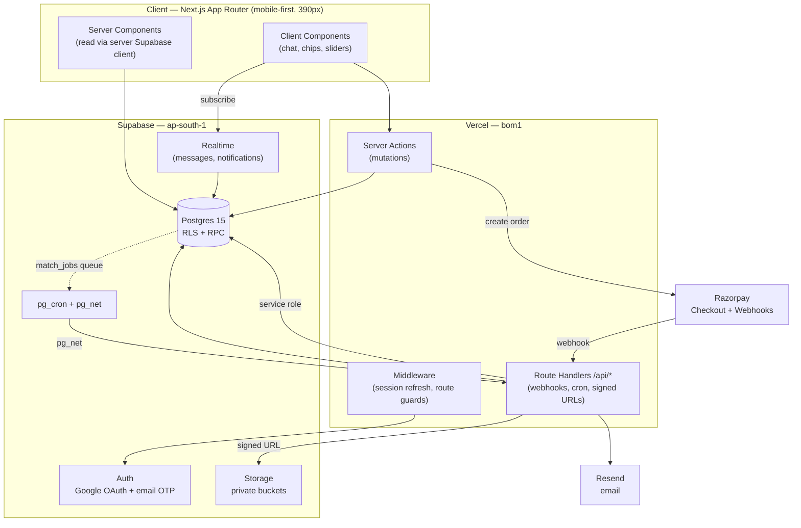
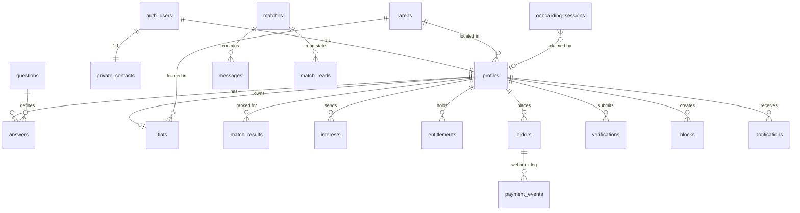
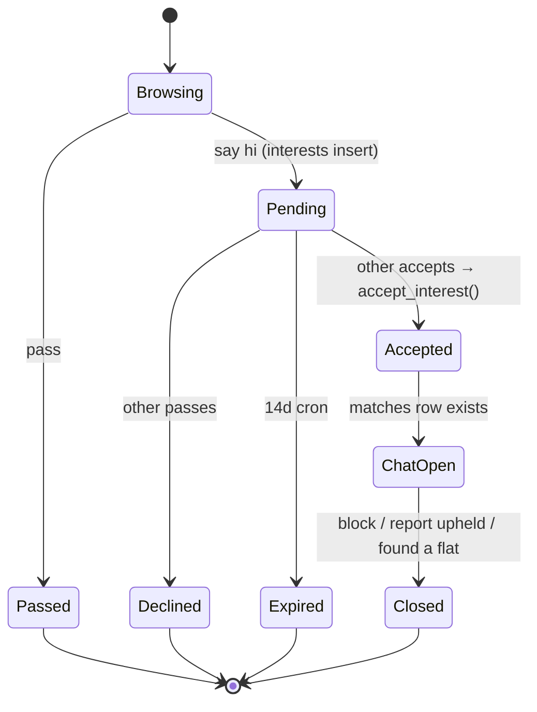

# Venn — Backend & Data Architecture

Status: **Proposed** · Target scale: **~1,000 monthly active users** · Stack: **Next.js (Vercel) + Supabase**

This document is the plan for everything behind the screens in `design_elements/`. It is meant to be read and challenged before any backend code is written. Companion doc: [HANDOFF.md](HANDOFF.md) (frontend contract).

---

## 1. Requirements

### 1.1 Functional

| # | Capability | Source screen |
|---|---|---|
| F1 | Anonymous 10-question onboarding chat; answers persist before signup | `Chat-role`, `Chat-mobile`, `Chat-resume` |
| F2 | Flat-owner branch collects room details + photos | `Flat-details` |
| F3 | Signup after the chat (Google OAuth + email OTP for v1), then anonymous answers attach to the new user | `Signup`, `OTP` |
| F4 | Async match computation with a visible "finding" state | `Finding` |
| F5 | Ranked match list; **free tier reveals only the top 2 in full** | `Results-locked`, `Results-mobile`, `No-matches` |
| F6 | Match detail: side-by-side answers, "why you match" tags, friction flags | `Match-detail` |
| F7 | One-time ₹99 unlock via UPI, with failure and success states | `Paywall`, `Checkout`, `Unlocked`, `Payment-failed` |
| F8 | "Say hi" interest → mutual accept → match → chat | `Requests`, `Its-a-match`, `Match-chat` |
| F9 | Realtime 1:1 chat with unread state | `Chats-list`, `Match-chat` |
| F10 | Notification feed | `Notifications` |
| F11 | Answer editing, re-take chat, profile settings | `Edit-answers`, `Settings` |
| F12 | Verification: email/work-email, phone, selfie; blue tick | `Verify` |
| F13 | Report + block with a 24h review SLA | `Report` |

### 1.2 Non-functional

| Attribute | Target | Why this number |
|---|---|---|
| Scale | 1,000 MAU; assume ~3,000 registered, peak ~60 concurrent | Stated target |
| Write volume | ~10k answer writes/mo, ~50k chat messages/mo, ~500 orders/mo | 1k MAU against a typical funnel |
| Latency | p95 < 400 ms for match list and chat send; match computation < 8 s (the `Finding` screen covers it) | Mobile-first, Indian 4G |
| Availability | 99.5%. A housing utility, not life-critical. No multi-region. | Keeps cost near zero |
| Durability | Chat and orders must never be lost. Match results are **derived and disposable**. | Lets us recompute freely |
| Privacy | Phone numbers and emails never leave the server. Locked-match names and photos are never serialised to the client. | HANDOFF business rules |
| Security | RLS on every table; no client ever holds a service-role key | Supabase-native posture |
| Compliance | India DPDP Act 2023: consent record, data export, delete-my-account | Indian user base |
| Cost ceiling | < $60/mo all-in at target scale | Early-stage product |

### 1.3 Constraints

- Vercel serverless: no long-lived processes, no in-memory state, ~10 s default function duration (60 s configurable), cold starts.
- Supabase: one Postgres instance. Connection pooling from serverless is mandatory, not optional.
- Single region. Use **ap-south-1 (Mumbai)** for Supabase and `bom1` for Vercel functions — the designs are Mumbai-first (Powai, Andheri W, Vile Parle, Lower Parel).

---

## 2. Hosting assessment

**Verdict: Vercel + Supabase is the right choice. No alternative is needed at this scale.** Supabase gives us Postgres, Auth, Storage, Realtime and cron on one bill, and RLS lets us enforce the privacy rules *in the database* rather than hoping every route handler remembers to.

Two things to get right:

1. **Supabase: use the Pro plan ($25/mo) for production, not Free.** Free-tier projects pause after 7 days of inactivity and have no point-in-time recovery. For a product holding paid orders that is unacceptable. Free tier is fine for `dev` and preview projects.
2. **Vercel: Pro ($20/mo).** The Hobby plan forbids commercial use, and we are charging ₹99.

| Need | Service | Cost/mo |
|---|---|---|
| Web + API | Vercel Pro | $20 |
| DB, Auth, Storage, Realtime, cron | Supabase Pro (ap-south-1) | $25 |
| Payments | Razorpay | 2% + GST per txn (~₹2.3 on ₹99) |
| Email OTP + transactional | Resend | $0 (3k/mo free) → $20 |
| Error tracking | Sentry | $0 (dev tier) |
| **Total fixed** | | **~$45–65/mo** |

Deliberately **not** added: Redis, a queue broker, a search service, a separate API server, containers. At 1k MAU each is operational cost with no payoff. Section 8 says what to add, when, and on what signal.

---

## 3. High-level architecture



### 3.1 Why a modular monolith inside Next.js

One deployable. All backend logic lives in `server/<domain>/` modules with explicit public interfaces, called from Server Actions and Route Handlers. No service boundaries, no network hops, no distributed transactions.

```
server/
  auth/          session, claim-onboarding
  onboarding/    questions config, answer validation, anon sessions
  matching/      scoring, job queue, projection + redaction
  billing/       razorpay adapter, order lifecycle, entitlements
  social/        interests, matches, blocks
  chat/          messages, read state
  trust/         verification, reports, moderation
  notify/        feed writes, email fan-out
  platform/      supabase clients, rate limit, logging, errors
```

One hard rule: domain modules may not import each other's internals, only each other's `index.ts`. That rule is what makes extracting a service later a mechanical job instead of a rewrite. `matching/` is the one most likely to leave (section 8.1).

### 3.2 The three Supabase clients

Getting this wrong is the single most likely source of a privacy bug, so it is a hard rule:

| Client | Key | Used in | RLS |
|---|---|---|---|
| `createBrowserClient()` | anon | Client Components, Realtime subscriptions | **Enforced** |
| `createServerClient()` | anon + user's cookie | Server Components, Server Actions | **Enforced** |
| `createAdminClient()` | service role | Only: webhooks, cron routes, `claimOnboardingSession`, moderation | **Bypassed** |

The admin client lives in exactly one file, exports a single function, and is the only place `SUPABASE_SERVICE_ROLE_KEY` is read. Add an ESLint `no-restricted-imports` rule so nothing under `app/**` can import it directly.

---

## 4. Data model



### 4.1 Identity and contact separation

```sql
-- Public-ish. Readable by other active users, subject to the redaction rules in §6.1.
create table profiles (
  id              uuid primary key references auth.users(id) on delete cascade,
  display_name    text not null,
  age             int  check (age between 18 and 99),
  occupation      text,                    -- "UX designer"
  employer        text,                    -- "Swiggy"
  role            user_role not null,      -- 'seeker' | 'haver'
  home_area_id    uuid references areas(id),
  avatar_path     text,                    -- Storage object path, NOT a URL
  ideal_sunday    text,                    -- free text shown on Match-detail
  pet_peeve       text,
  status          profile_status not null default 'onboarding',
                  -- 'onboarding'|'active'|'paused'|'found_flat'|'banned'
  is_verified     boolean not null default false,   -- derived, see §4.8
  last_active_at  timestamptz not null default now(),
  created_at      timestamptz not null default now()
);

-- Never readable by anyone but the owner. No policy grants SELECT to a third party.
create table private_contacts (
  user_id           uuid primary key references auth.users(id) on delete cascade,
  phone_e164        text unique,
  email             text,
  phone_verified_at timestamptz,
  email_verified_at timestamptz
);
```

The split is deliberate. "Phone numbers are never exposed to other users" becomes a *structural* guarantee: there is no policy on `private_contacts` granting a third party `select`, so no API route can leak it even by accident. A nullable `phone_e164` column on `profiles` would eventually be swept up by a `select *`.

### 4.2 Questions as data, not code

The chat is 10 questions today. It will not be 10 forever, and re-deploying to reword a question is silly.

```sql
create table questions (
  key           text primary key,          -- 'sleep', 'cleanliness', 'budget'
  sort_order    int  not null,
  prompt        text not null,             -- bot bubble copy
  helper        text,
  answer_kind   answer_kind not null,
      -- 'single_choice'|'multi_choice'|'scale'|'range'|'free_text'|'area_multi'
  options       jsonb,                     -- [{value,label,emoji,ordinal}]
  comparator    comparator not null,
      -- 'exact'|'ordinal'|'range_overlap'|'set_overlap'|'none'
  weight        numeric(4,2) not null default 1.0,
  friction_sensitive boolean not null default false,
  asked_of      user_role[] not null default '{seeker,haver}',
  is_active     boolean not null default true,
  version       int not null default 1
);

create table answers (
  user_id      uuid not null references profiles(id) on delete cascade,
  question_key text not null references questions(key),
  value        jsonb not null,    -- {"choice":"night_owl"} | {"min":18000,"max":22000}
  ordinal      numeric,           -- denormalised for fast ordinal comparison
  updated_at   timestamptz not null default now(),
  primary key (user_id, question_key)
);
create index on answers (question_key, ordinal);
```

`comparator` is the key field: it tells the scoring function *how* to compare two answers, so adding a question never means editing the scorer. `weight` and `friction_sensitive` let a product person tune matching with an UPDATE.

### 4.3 Anonymous onboarding, then claim

```sql
create table onboarding_sessions (
  id           uuid primary key default gen_random_uuid(),
  answers      jsonb not null default '{}',
  role         user_role,
  flat_draft   jsonb,            -- Flat-details branch
  step         int not null default 0,
  claimed_by   uuid references profiles(id),
  claimed_at   timestamptz,
  user_agent   text,
  ip_hash      text,             -- hashed; abuse throttling only
  created_at   timestamptz not null default now(),
  expires_at   timestamptz not null default now() + interval '7 days'
);
create index on onboarding_sessions (expires_at) where claimed_by is null;
```

The session id goes to the browser in an `httpOnly`, `secure`, `sameSite=lax` cookie — **not** `localStorage`, so it survives the OAuth redirect round-trip and is unreachable from JS. This is what makes `Chat-resume` work, and what makes the handoff rule ("store answers against an anonymous session first, then attach them after OTP") real rather than aspirational.

Claiming is one transaction, and it is idempotent — a double-submitted signup must not duplicate answers:

```sql
create or replace function claim_onboarding_session(p_session_id uuid, p_user_id uuid)
returns void language plpgsql security definer set search_path = public, pg_temp as $$
declare s onboarding_sessions;
begin
  select * into s from onboarding_sessions
    where id = p_session_id and claimed_by is null and expires_at > now()
    for update;
  if not found then raise exception 'session_unclaimable' using errcode = 'P0001'; end if;

  insert into answers (user_id, question_key, value, ordinal)
  select p_user_id, k, v, question_ordinal(k, v)
  from jsonb_each(s.answers) as e(k, v)
  on conflict (user_id, question_key) do update
    set value = excluded.value, ordinal = excluded.ordinal, updated_at = now();

  update profiles set role = s.role, status = 'active' where id = p_user_id;
  if s.flat_draft is not null then perform upsert_flat(p_user_id, s.flat_draft); end if;
  update onboarding_sessions set claimed_by = p_user_id, claimed_at = now()
    where id = p_session_id;
  perform compute_matches_for(p_user_id);   -- priority-1 path, see §5.2
end $$;
```

Unclaimed sessions are deleted after 7 days by cron. No orphan PII.

### 4.4 Areas and coverage

```sql
create table areas (
  id       uuid primary key default gen_random_uuid(),
  city     text not null,            -- 'Mumbai'
  name     text not null,            -- 'Powai'
  slug     text not null unique,
  centroid geography(point, 4326),
  is_live  boolean not null default false,   -- coverage gate
  unique (city, name)
);

-- Hand-curated "these are commutable neighbours" graph. Beats a radius circle
-- in a city where a 3 km hop can mean a 50-minute commute.
create table area_adjacency (
  area_id      uuid references areas(id) on delete cascade,
  neighbour_id uuid references areas(id) on delete cascade,
  closeness    numeric(3,2) not null default 0.5,   -- 1.0 = same area
  primary key (area_id, neighbour_id)
);
```

`is_live` answers the open "coverage areas" question operationally: launch with Powai, Andheri W, Vile Parle and Lower Parel live, and show `No-matches` with a waitlist for anything else.

### 4.5 Flats

```sql
create table flats (
  id             uuid primary key default gen_random_uuid(),
  owner_id       uuid not null unique references profiles(id) on delete cascade,
  area_id        uuid not null references areas(id),
  rent_share_paise int not null,
  deposit_paise    int,
  bhk            text,                       -- '2BHK'
  amenities      text[] not null default '{}',  -- furnished, own_bathroom, balcony
  available_from date,
  photo_paths    text[] not null default '{}',  -- private Storage paths
  created_at     timestamptz not null default now()
);
```

### 4.6 Match results: cached projections

```sql
create table match_results (
  user_id      uuid not null references profiles(id) on delete cascade,
  candidate_id uuid not null references profiles(id) on delete cascade,
  score        int  not null check (score between 0 and 100),
  rank         int  not null,
  breakdown    jsonb not null,  -- {"sleep":{"sim":1.0,"w":1.5}, ...}
  reasons      jsonb not null,  -- [{"key":"sleep","label":"Both night owls"}]
  frictions    jsonb not null,  -- [{"key":"guests","label":"She hosts weekends..."}]
  computed_at  timestamptz not null default now(),
  primary key (user_id, candidate_id)
);
create index on match_results (user_id, rank);
create index on match_results (user_id, score desc);
```

This table is **derived state and is always safe to truncate**. That property is worth protecting: a scoring bug is then fixed by shipping a new scorer and recomputing, not by a data migration.

`rank` is stored rather than computed at read time so the free tier's top 2 is *stable*. If rank were computed per request, a user's free matches could silently swap between page loads — confusing, and it would let someone refresh their way into seeing more than two profiles.

### 4.7 Interests, matches, messages

```sql
create table interests (
  id           uuid primary key default gen_random_uuid(),
  from_user    uuid not null references profiles(id) on delete cascade,
  to_user      uuid not null references profiles(id) on delete cascade,
  note         text,                    -- "Hey! Saw we both cook daily..."
  status       interest_status not null default 'pending',
               -- 'pending'|'accepted'|'passed'|'expired'|'withdrawn'
  responded_at timestamptz,
  created_at   timestamptz not null default now(),
  unique (from_user, to_user),
  check (from_user <> to_user)
);

-- Canonical ordering (user_a < user_b) makes "do we have a match?" a
-- primary-key lookup and makes a duplicate match physically impossible.
create table matches (
  id            uuid primary key default gen_random_uuid(),
  user_a        uuid not null references profiles(id) on delete cascade,
  user_b        uuid not null references profiles(id) on delete cascade,
  created_at    timestamptz not null default now(),
  closed_at     timestamptz,
  closed_reason text,
  unique (user_a, user_b),
  check (user_a < user_b)
);

create table messages (
  id         bigint generated always as identity primary key,
  match_id   uuid not null references matches(id) on delete cascade,
  sender_id  uuid not null references profiles(id),
  body       text not null check (length(body) between 1 and 2000),
  created_at timestamptz not null default now()
);
create index on messages (match_id, id desc);

-- A watermark, not a per-message read flag: one row per participant per thread
-- instead of one per message, so unread counts stay a single cheap query.
create table match_reads (
  match_id     uuid references matches(id) on delete cascade,
  user_id      uuid references profiles(id) on delete cascade,
  last_read_id bigint not null default 0,
  primary key (match_id, user_id)
);
```

### 4.8 Billing

```sql
create table orders (
  id                 uuid primary key default gen_random_uuid(),
  user_id            uuid not null references profiles(id),
  amount_paise       int  not null,        -- 9900. Integers only. Never float.
  currency           text not null default 'INR',
  gateway            text not null default 'razorpay',
  gateway_order_id   text unique,
  gateway_payment_id text unique,
  status             order_status not null default 'created',
                     -- 'created'|'attempted'|'paid'|'failed'|'refunded'
  failure_reason     text,
  created_at         timestamptz not null default now(),
  paid_at            timestamptz
);

-- Every webhook body, deduped by the gateway's own event id.
-- This is the idempotency boundary and the audit trail.
create table payment_events (
  id               bigint generated always as identity primary key,
  gateway_event_id text not null unique,
  order_id         uuid references orders(id),
  event_type       text not null,
  payload          jsonb not null,
  signature_ok     boolean not null,
  processed_at     timestamptz,
  received_at      timestamptz not null default now()
);

create table entitlements (
  id         uuid primary key default gen_random_uuid(),
  user_id    uuid not null references profiles(id) on delete cascade,
  kind       text not null,          -- 'unlock_all'
  source     text not null,          -- 'purchase'|'grant'|'promo'
  order_id   uuid references orders(id),
  granted_at timestamptz not null default now(),
  revoked_at timestamptz
);
create unique index on entitlements (user_id, kind) where revoked_at is null;
```

Entitlements are a separate table from orders on purpose. Granting a free unlock to an early user, or to someone whose payment half-failed, must not require faking an order. And "is this user unlocked?" stays one indexed lookup regardless of how many retries and refunds litter their order history.

### 4.9 Trust and safety

```sql
create table verifications (
  id           uuid primary key default gen_random_uuid(),
  user_id      uuid not null references profiles(id) on delete cascade,
  method       verify_method not null,   -- 'phone'|'email'|'work_email'|'selfie'
  status       verify_status not null default 'pending',
  evidence_ref text,                     -- Storage path; never the image in the DB
  reviewed_by  uuid,
  verified_at  timestamptz,
  created_at   timestamptz not null default now(),
  unique (user_id, method)
);

create table blocks (
  blocker_id uuid references profiles(id) on delete cascade,
  blocked_id uuid references profiles(id) on delete cascade,
  created_at timestamptz not null default now(),
  primary key (blocker_id, blocked_id)
);

create table reports (
  id          uuid primary key default gen_random_uuid(),
  reporter_id uuid not null references profiles(id),
  reported_id uuid not null references profiles(id),
  match_id    uuid references matches(id),
  reason      report_reason not null,
      -- 'fake_profile'|'asked_for_money'|'harassment'|'other'
  detail      text,
  status      report_status not null default 'open',   -- 24h SLA
  resolution  text,
  created_at  timestamptz not null default now()
);
create index on reports (status, created_at) where status = 'open';
```

`profiles.is_verified` is maintained by a trigger on `verifications` and never written directly, so the blue tick cannot drift from the evidence behind it.

A block is bidirectionally invisible: a hard filter in matching, it hides existing `match_results` rows in both directions and closes any open match. Implemented once as an `is_visible_to(viewer, subject)` SQL function used by every policy and query, so there is exactly one place to get it right.

---

## 5. The matching engine

### 5.1 Scoring model

Score is a weighted mean of per-dimension similarities, each in `[0,1]`:

```
score = round(100 * Σ(wᵢ · simᵢ) / Σ(wᵢ))
```

`simᵢ` depends on the question's `comparator`:

| Comparator | Similarity | Example |
|---|---|---|
| `exact` | `1.0` if equal, else `0.0` (or a per-option affinity matrix) | smoking / drinking |
| `ordinal` | `1 − |a−b| / range` | cleanliness 4 vs 4 → 1.0; 4 vs 1 → 0.25 |
| `range_overlap` | `overlap / min(width_a, width_b)` | budget ₹18–22k vs ₹20–25k → 0.5 |
| `set_overlap` | Jaccard, weighted by `area_adjacency.closeness` | localities |
| `none` | excluded from scoring | ideal Sunday, pet peeve (shown, not scored) |

**Hard filters** run before scoring. They are predicates, not score penalties, because "would never work" should not be rescuable by scoring 98% elsewhere:

- both profiles `status = 'active'`
- area is `is_live` and the two areas are adjacent (or identical)
- role compatible: `seeker↔haver`, and `seeker↔seeker` (team up on a place); never `haver↔haver`
- no block in either direction
- budget ranges overlap at all
- no existing `passed` interest in either direction

**Reasons and frictions fall out of the same pass.** Dimensions with `sim ≥ 0.85` become "why you match" tags; dimensions with `sim ≤ 0.4` **and** `friction_sensitive = true` become heads-up flags. This is exactly what `Match-detail` renders, and it means the explanation can never disagree with the number — both come from one `breakdown`.

The whole thing is a pure SQL function, `compute_matches_for(p_user uuid)`. Deterministic, testable against fixtures, no network calls, and fast because the data is already in Postgres.

### 5.2 Freshness: queue + cron, not triggers

```sql
create table match_jobs (
  id         bigint generated always as identity primary key,
  user_id    uuid not null references profiles(id) on delete cascade,
  reason     text not null,  -- 'answers_changed'|'new_neighbour'|'backfill'
  priority   int not null default 5,
  attempts   int not null default 0,
  locked_at  timestamptz,
  created_at timestamptz not null default now()
);
create unique index on match_jobs (user_id) where locked_at is null;
```

Recomputation is enqueued when:

1. A user finishes onboarding → **run inline**, inside `claim_onboarding_session`.
2. A user edits an answer → **run inline** on save. `Edit-answers` promises "matches refresh instantly", so this one cannot wait for cron.
3. A new user becomes active in a live area → a priority-5 job for every active user in that area and its neighbours. This is the fan-out, and it is the reason a queue exists at all.
4. Nightly backfill → priority 9, catching anything dropped.

Workers: `pg_cron` runs every minute and calls a Vercel route handler via `pg_net`; the handler claims a batch of up to 50 jobs with `FOR UPDATE SKIP LOCKED` and runs the SQL function for each. `SKIP LOCKED` means overlapping cron ticks cannot double-process, and the partial unique index collapses duplicate pending jobs for the same user.

Because the onboarding path is inline, the `Finding` screen is covering a real 1–3 s wait, not a fake one. It polls `match_results` for the viewer and advances when rows exist.

### 5.3 Cost at 1,000 MAU

~1,000 active profiles. A Mumbai neighbourhood cluster holds maybe 250 candidates after hard filters. One user's recompute is a 250-row scan with ~10 jsonb comparisons each — low single-digit milliseconds. A new signup fans out to ~250 recomputes, so ~250 × 3 ms ≈ 1 s of DB time spread across a minute of cron. At 1,000 signups/month that is **roughly 20 minutes of total DB time per month.**

This design does not need to change until roughly 50,000 active profiles, and the thing that breaks first is the fan-out, not the scoring.

---

## 6. Enforcing the business rules server-side

The handoff is explicit that these must be real, not UI state. Each gets a specific mechanism.

### 6.1 Free tier: the client never receives locked data

Not "the client gets it and blurs it". The bytes are never serialised. One RPC owns the projection:

```sql
create or replace function get_match_list(p_viewer uuid)
returns table (
  candidate_id uuid, rank int, score int, is_locked boolean,
  area_name text,
  display_name text, age int, occupation text, avatar_path text,
  reasons jsonb, frictions jsonb, is_verified boolean
) language sql security definer stable set search_path = public, pg_temp as $$
  with ent as (
    select exists (
      select 1 from entitlements
      where user_id = p_viewer and kind = 'unlock_all' and revoked_at is null
    ) as unlocked
  )
  select
    mr.candidate_id, mr.rank, mr.score,
    not (e.unlocked or mr.rank <= 2)                      as is_locked,
    a.name,
    case when e.unlocked or mr.rank <= 2 then p.display_name end,
    case when e.unlocked or mr.rank <= 2 then p.age end,
    case when e.unlocked or mr.rank <= 2 then p.occupation end,
    case when e.unlocked or mr.rank <= 2 then p.avatar_path end,
    case when e.unlocked or mr.rank <= 2
         then mr.reasons
         else jsonb_build_array(mr.reasons -> 0)           -- exactly one tag
    end,
    case when e.unlocked or mr.rank <= 2 then mr.frictions else '[]'::jsonb end,
    case when e.unlocked or mr.rank <= 2 then p.is_verified else false end
  from match_results mr
  join profiles p on p.id = mr.candidate_id
  left join areas a on a.id = p.home_area_id
  cross join ent e
  where mr.user_id = p_viewer and is_visible_to(p_viewer, mr.candidate_id)
  order by mr.rank;
$$;
```

For a locked row, `display_name` and `avatar_path` come back as SQL `NULL`. The payload physically cannot leak a name. The client's blur is then purely cosmetic — the only safe place for a blur to live.

`/app/matches/[id]` re-checks on the server: if `rank > 2` and there is no entitlement, it returns 403 and redirects to `/app/unlock`. No guess-the-UUID bypass.

### 6.2 Chat only after a mutual yes

Three layers, because this one matters:

1. **Structure.** A `matches` row is created *only* by `accept_interest()`, in the same transaction that flips the reciprocal interest to `accepted`. `messages.match_id` is `NOT NULL` with an FK. No match row ⇒ no message can exist.
2. **RLS.**
   ```sql
   create policy msg_insert on messages for insert to authenticated
   with check (
     sender_id = auth.uid()
     and exists (
       select 1 from matches m
       where m.id = match_id and m.closed_at is null
         and auth.uid() in (m.user_a, m.user_b)
     )
   );
   ```
3. **Realtime.** The `messages` publication is filtered by the same policy, so a client cannot subscribe to a thread it is not in.

`accept_interest` is also the only place an "It's a match" notification is written, so `Its-a-match` can never fire for a one-sided yes:

```sql
create or replace function accept_interest(p_interest_id uuid)
returns uuid language plpgsql security definer set search_path = public, pg_temp as $$
declare i interests; m_id uuid; a uuid; b uuid;
begin
  select * into i from interests
    where id = p_interest_id and to_user = auth.uid() and status = 'pending'
    for update;
  if not found then raise exception 'interest_not_actionable'; end if;

  update interests set status = 'accepted', responded_at = now() where id = i.id;
  insert into interests (from_user, to_user, status, responded_at)
    values (i.to_user, i.from_user, 'accepted', now())
    on conflict (from_user, to_user)
      do update set status = 'accepted', responded_at = now();

  a := least(i.from_user, i.to_user);
  b := greatest(i.from_user, i.to_user);
  insert into matches (user_a, user_b) values (a, b)
    on conflict (user_a, user_b) do nothing
    returning id into m_id;
  if m_id is null then
    select id into m_id from matches where user_a = a and user_b = b;
  end if;

  insert into match_reads (match_id, user_id) values (m_id, a), (m_id, b)
    on conflict do nothing;
  perform notify_user(i.from_user, 'match_created', jsonb_build_object('match_id', m_id));
  perform notify_user(i.to_user,   'match_created', jsonb_build_object('match_id', m_id));
  return m_id;
end $$;
```

### 6.3 Photos: signed URLs, never public

Avatars and room photos live in **private** Supabase Storage buckets. `avatar_path` is an object path, not a URL. A short-lived signed URL (300 s) is minted server-side only after `is_visible_to()` and the lock check both pass. A locked match never gets a signed URL at all, so the image bytes are not fetchable — not even by reading the DOM.

### 6.4 Payment: the webhook is the source of truth

```mermaid
sequenceDiagram
    participant C as Client
    participant V as Server Action
    participant DB as Postgres
    participant RP as Razorpay
    participant W as /api/webhooks/razorpay

    C->>V: createUnlockOrder()
    V->>DB: insert orders (status=created, 9900)
    V->>RP: POST /orders (receipt = our order id)
    V->>DB: store gateway_order_id
    V-->>C: {gatewayOrderId, keyId}
    C->>RP: Razorpay Checkout (UPI)
    RP-->>C: success / failure callback (DISPLAY ONLY)
    RP->>W: payment.captured (signed, authoritative)
    W->>DB: insert payment_events (unique gateway_event_id)
    W->>DB: orders → paid; insert entitlement  [one txn]
    W-->>C: Realtime: entitlement granted
    C->>C: route to /app/matches (Unlocked)
```

Non-negotiables:

- **Verify the HMAC** (`X-Razorpay-Signature`) against the **raw** body before parsing. Reject unsigned requests.
- **The client callback never grants anything.** It only decides whether to show `Unlocked` or `Payment-failed`. The entitlement comes from the webhook. Otherwise a crafted callback buys the unlock for free.
- **Idempotent on `gateway_event_id`.** Razorpay retries; the unique index turns a replay into a no-op.
- **Order status and entitlement in one transaction.** Never "paid but not unlocked".
- **Reconciliation.** A nightly cron re-queries Razorpay for any order stuck in `attempted` for over 30 minutes and settles it. Webhooks do get lost; this is the safety net, and it is also what makes the 7-day refund promise auditable.
- The amount is validated server-side against the price config. The client never sends an amount.

`Payment-failed` reads `orders.failure_reason`, so "UPI timed out" and "insufficient funds" can say different things.

### 6.5 RLS policy baseline

RLS is enabled on every table in `public`. Nothing is readable by default.

| Table | select | insert / update |
|---|---|---|
| `profiles` | self, plus `is_visible_to(auth.uid(), id)` for active users | self only (name, age, bio) |
| `private_contacts` | **self only** | self only |
| `answers` | self; others' answers only via `get_match_detail()` | self only |
| `match_results` | self (`user_id = auth.uid()`); the app always reads through the RPC | nobody (service role only) |
| `interests` | self as sender or recipient | insert as sender; respond only as recipient |
| `matches` | participants | nobody (`accept_interest` only) |
| `messages` | participants of an open match | insert as sender, in own match |
| `orders`, `entitlements` | self | nobody (service role only) |
| `reports` | reporter sees own | insert as reporter |
| `questions`, `areas` | any authenticated user | nobody |

Two habits make this hold up: every policy is covered by a pgTAP test asserting user B **cannot** read user A's row, and every `security definer` function sets `search_path = public, pg_temp` to close the privilege-escalation hole.

### 6.6 Abuse controls

Rate limits live in Postgres — a Redis dependency is not worth it at this scale:

```sql
create table rate_limits (
  bucket       text not null,     -- 'otp:a@b.com', 'interest:<uuid>'
  window_start timestamptz not null,
  count        int not null default 0,
  primary key (bucket, window_start)
);
```

| Action | Limit |
|---|---|
| Email OTP request | 5 / hour per email; 20 / hour per IP hash |
| Onboarding session create | 10 / hour per IP hash |
| Interest sent | 20 / day per user |
| Message sent | 60 / minute per match |
| Report filed | 10 / day per user |

Plus Vercel's WAF for bot filtering on `/api/*`, and an `Idempotency-Key` on order creation so a double-tap on "Pay ₹99" cannot create two orders.

---

## 7. Request flows

### 7.1 Onboarding → signup → matches

```mermaid
sequenceDiagram
    participant U as User
    participant N as Next.js
    participant DB as Postgres
    participant A as Supabase Auth

    U->>N: GET /app/chat
    N->>DB: create onboarding_session
    N-->>U: set httpOnly cookie; render Chat-role
    loop 10 questions
        U->>N: answer (Server Action)
        N->>DB: validate against questions.options; patch session.answers
    end
    U->>N: GET /app/signup
    U->>A: Google OAuth  OR  email OTP
    A-->>N: session cookie
    N->>DB: claim_onboarding_session(cookie, user.id)
    Note over DB: copy answers · activate profile · compute matches
    N-->>U: /app/finding
    DB-->>N: match_results present
    N-->>U: /app/matches → get_match_list()
```

Answers are validated against `questions.options` on every write, so a client cannot invent a value the scorer has never seen.

### 7.2 Interest → match → chat



Sending interest requires that the target be unlocked for the sender. Otherwise the ₹99 gate ("say hi to anyone you match with") is bypassable by anyone who learns a UUID.

### 7.3 API surface

Mutations are Server Actions (typed, no hand-written fetch). Route handlers exist only where an external caller needs a URL.

| Route handler | Purpose | Auth |
|---|---|---|
| `POST /api/webhooks/razorpay` | payment events | HMAC signature |
| `POST /api/cron/match-worker` | drain `match_jobs` | `CRON_SECRET` bearer |
| `POST /api/cron/reconcile-orders` | settle stuck orders | `CRON_SECRET` |
| `POST /api/cron/expire` | expire interests; purge unclaimed sessions | `CRON_SECRET` |
| `POST /api/cron/nudge` | "we'll nudge him" reminders, new-match digests | `CRON_SECRET` |
| `GET  /api/media/[path]` | mint a signed Storage URL after a visibility check | user session |

| Server Action | Guard |
|---|---|
| `saveOnboardingAnswer` | session cookie; value ∈ `options` |
| `claimSession` | fresh auth session |
| `updateAnswer` | self; recomputes inline |
| `listMatches` / `getMatchDetail` | `get_match_list` / `get_match_detail` RPC |
| `sendInterest` | unlocked for target; rate limit; not blocked |
| `acceptInterest` / `passInterest` | recipient only |
| `sendMessage` | participant of an open match |
| `createUnlockOrder` | idempotency key; server-side amount |
| `submitVerification` | self; one pending per method |
| `reportUser` / `blockUser` | rate limit; block closes the match |
| `deleteMyAccount` | DPDP; cascades, but retains orders 7 years for tax with PII nulled |

Cron is Supabase `pg_cron` + `pg_net` rather than Vercel Cron, because Vercel Pro caps cron at daily granularity — far too coarse for a one-minute match worker. Vercel Cron is still fine for the daily digest.

---

## 8. Scalability, risk, failure modes

### 8.1 What breaks, and when

| Bottleneck | Breaks around | Fix when it does |
|---|---|---|
| Serverless connection exhaustion | immediately, if misconfigured | Supabase **Supavisor in transaction mode** from day one. Non-negotiable. |
| New-signup match fan-out (O(n) per signup) | ~50k active profiles | Batch into area-level recompute windows, or move scoring to a worker on Fly.io / Railway |
| `match_results` row count (n² within an area) | ~100k profiles | Cap to top 200 per user; partition by area |
| `messages` table size | ~50M rows | Partition by month; archive closed matches to cold storage |
| Postgres CPU / connection ceiling | ~10k MAU | Scale the Supabase instance up. Vertical first — it is cheap and buys a lot. |
| Vercel function duration on the match worker | if a batch exceeds 60 s | Shrink the batch; the queue already makes this safe |

At 1,000 MAU none of these are near. The architecture is deliberately sized for one order of magnitude of headroom, not three.

### 8.2 Failure modes

| Failure | Blast radius | Mitigation |
|---|---|---|
| Razorpay webhook lost | user paid, not unlocked | Nightly reconciliation; support can grant an entitlement directly |
| Razorpay down | no new unlocks | Paywall degrades to "try again shortly"; free tier keeps working |
| Match worker stalled | stale match lists | `locked_at` timeout re-queues after 5 min; alert when `match_jobs` depth > 500 |
| Supabase Realtime down | chat stops updating live | Client falls back to 10 s polling on the same table. Chat degrades, does not break. |
| Email OTP undelivered | signup blocked | Google OAuth is the alternate path — which is why v1 ships both |
| Scoring bug ships | wrong match % for everyone | `match_results` is derived: fix the function, enqueue a full backfill |
| PII leak in a response | serious | `private_contacts` separation + the `get_match_list` projection + a CI test asserting no response body contains a phone-shaped string |
| DB data loss | existential | Supabase Pro PITR (7 days) + a nightly `pg_dump` to object storage |

### 8.3 Open risks

1. **Cold start problem.** Matching is worthless with 20 users in an area. This is a product risk rather than a technical one, but the architecture supports managing it: `areas.is_live` gates launch to one neighbourhood at a time, and `No-matches` carries a waitlist. Seed one locality to critical mass before opening the next.
2. **Selfie verification.** Face-match needs a vendor (AWS Rekognition, IDfy). Until one is chosen, `verifications` accepts selfies and queues them for manual review — the schema does not change when a vendor arrives.
3. **Phone auth deferred.** v1 is Google OAuth + email OTP, so `private_contacts.phone_e164` is nullable and the `Verify` screen's phone row starts as an unverified add-on. The designs assume phone OTP at signup; when SMS and DLT are sorted, phone becomes a third `verify_method` and optionally a login factor. **No schema change required** — the main reason contacts are a separate table.
4. **Refund policy.** Checkout promises "refunds within 7 days". `orders.status = 'refunded'` must revoke the entitlement (`revoked_at`), and the UI must handle a user dropping back to the free tier mid-session.
5. **GST and invoicing.** ₹99 collections need GST treatment once the entity crosses the threshold. Keep `amount_paise` as the gross and add a `tax_breakup jsonb` column before the first invoice is needed.

---

## 9. Architecture Decision Records

### ADR-001: Modular monolith on Vercel, not microservices

**Status:** Accepted

**Context.** A matching app with chat, payments and moderation has several plausible service boundaries. The target is 1,000 MAU with a small team.

**Decision.** One Next.js deployment with enforced internal module boundaries under `server/<domain>/`.

**Alternatives considered.**
- *Microservices* — correct boundaries, but at this scale it buys distributed tracing, eventual consistency and 5× the deploy surface in exchange for nothing a single Postgres cannot do.
- *Separate API server (Fastify / NestJS)* — better for long-running work, but it splits the type-safe Server Action path and doubles hosting.

**Consequences.** Positive: one deploy, one log stream, local transactions, end-to-end type safety for free. Negative: no independent scaling; a bad deploy takes everything down; module boundaries are enforced only by lint rules.

**Trade-off.** Iteration speed and operational simplicity over independent scalability we will not need for two orders of magnitude.

---

### ADR-002: Postgres as the only datastore

**Status:** Accepted

**Context.** The app needs relational data, a job queue, realtime pub/sub, and a cache.

**Decision.** Postgres for all four: tables for relations, `match_jobs` + `FOR UPDATE SKIP LOCKED` for the queue, Supabase Realtime (logical replication) for pub/sub, `match_results` as the cache.

**Alternatives considered.**
- *+ Redis* — better queue and rate-limit primitives, but another service to run and reason about for a workload of ~1,000 jobs/day.
- *+ SQS / QStash* — managed, but adds a network hop and loses transactional enqueue. Being able to enqueue a match job *in the same transaction* as the answer write is genuinely valuable.
- *MongoDB* — the data is deeply relational and we lean on RLS; a document store is the wrong shape.

**Consequences.** Positive: one backup story, one connection pool, transactional enqueue, no cache-invalidation race. Negative: queue throughput caps far lower than a real broker; heavy queue polling competes with app queries for connections.

**Trade-off.** One system to operate over best-in-class components. Revisit if `match_jobs` sustains > 100k/day.

---

### ADR-003: Precomputed, cached match results with a stored rank

**Status:** Accepted

**Context.** Match lists need a stable top 2 for the free tier, a visible compute step (`Finding`), and explanations consistent with the percentage.

**Decision.** Compute in a SQL function; persist to `match_results` with `rank`, `breakdown`, `reasons`, `frictions`. Refresh via `match_jobs`, inline for the two user-visible cases.

**Alternatives considered.**
- *Compute per request* — simplest, but rank drifts between loads (letting users refresh their way past the paywall) and it repeats work on a list that changes rarely.
- *pgvector embeddings over free-text answers* — more "intelligent", but opaque: we could not produce an honest "94% because you're both night owls" or a specific friction flag, and that explanation is the product's whole differentiator.

**Consequences.** Positive: fast reads; stable ranks; explanations provably consistent with scores; weights tunable via `questions.weight`; the derived table is safe to truncate and rebuild. Negative: a staleness window (bounded to ~1 min by cron); n² storage within an area; fan-out cost on each signup.

**Trade-off.** Read performance and explainability over perfect freshness.

---

### ADR-004: Anonymous onboarding session, claimed after auth

**Status:** Accepted

**Context.** The 10-question chat precedes signup. Answers must survive an OAuth redirect and a refresh, and must not be lost if the user abandons signup.

**Decision.** A server-side `onboarding_sessions` row keyed by an `httpOnly` cookie, claimed into `answers` by one idempotent `security definer` transaction.

**Alternatives considered.**
- *localStorage* — no server copy, lost on device switch, reachable by injected JS, and we could not measure funnel drop-off.
- *Create a shadow `auth.users` upfront* — pollutes the user table with abandoned signups and complicates every "active user" query.

**Consequences.** Positive: `Chat-resume` works across the OAuth round-trip; the funnel is measurable; the claim is idempotent under double-submit. Negative: anonymous rows need TTL cleanup and are an abuse surface — mitigated by IP-hash rate limits and a 7-day purge.

---

### ADR-005: Payment entitlement granted only by a verified webhook

**Status:** Accepted

**Context.** A ₹99 UPI unlock. Client-side success callbacks are forgeable.

**Decision.** Razorpay. The entitlement is written only by the HMAC-verified webhook handler, in one transaction with the order status. The client callback is display-only. A nightly reconciliation covers lost webhooks.

**Alternatives considered.**
- *Trust the client callback* — trivially exploitable.
- *Poll Razorpay after redirect* — works, but adds latency to the success screen and still needs the webhook for async UPI confirmations, which can land minutes later.

**Consequences.** Positive: unforgeable; replay-safe via `gateway_event_id`; a full audit trail in `payment_events`; refunds revoke cleanly. Negative: a brief "paid but not yet unlocked" window on slow webhooks — covered by a Realtime subscription on `entitlements` so the UI flips the moment it lands.

---

### ADR-006: Private Storage buckets with server-minted signed URLs

**Status:** Accepted

**Context.** "Never send names or photos to the client and blur them there."

**Decision.** Private buckets. Store object paths. Mint 300 s signed URLs server-side after the visibility and lock checks. Locked matches get no URL at all.

**Alternatives considered.**
- *Public bucket + CSS blur* — the real image is one devtools inspection away.
- *Server-rendered blurred derivative* — still leaks the existence and rough look of a paid profile, and costs image processing.

**Consequences.** Positive: the paywall and the privacy rule are both cryptographically real. Negative: no plain CDN caching of avatars; a signed-URL mint on each render (cheap, but a per-request cost); expired URLs need a refresh path on long-lived pages.

---

### ADR-007: Row Level Security as the primary authorization boundary

**Status:** Accepted

**Context.** Multiple read paths (Server Components, Server Actions, Realtime) touch the same tables. Authorization duplicated per path will diverge.

**Decision.** RLS on every table, deny by default. Application code uses the user-scoped client. The service role is confined to one module and used only for webhooks, cron, claim and moderation.

**Alternatives considered.**
- *Application-layer checks only* — every new query is a chance to forget one, and Realtime subscriptions bypass route handlers entirely.
- *Service role everywhere + manual checks* — fast, and exactly how privacy incidents happen.

**Consequences.** Positive: a forgotten `where user_id = …` fails closed; Realtime inherits the same rules; policies are unit-testable with pgTAP. Negative: policies are harder to debug than `if` statements; `security definer` functions need `search_path` discipline; some queries need a `security definer` RPC to join across policy boundaries — which is exactly what `get_match_list` is.

---

### ADR-008: Google OAuth + email OTP for v1; phone auth deferred

**Status:** Accepted — supersedes the handoff's phone-OTP assumption for v1

**Context.** Indian SMS requires DLT registration and a provider contract: weeks of lead time. The designs assume phone OTP at signup.

**Decision.** Ship Google OAuth + email OTP (the `Signup` and `OTP` screens serve the email code). Keep phone as a nullable field in `private_contacts` and as a `verify_method` on the `Verify` screen.

**Alternatives considered.**
- *Block launch on DLT + MSG91* — correct long-term, but it delays launch for a paperwork dependency.
- *WhatsApp OTP (Gupshup / AiSensy)* — strong Indian delivery rates, but a bespoke auth flow outside Supabase Auth, which is real work to build and secure.

**Consequences.** Positive: launch is not gated on telecom paperwork; two independent login paths from day one; no schema change when phone arrives. Negative: a weaker identity signal than a verified phone, so expect more fake profiles early — partly offset by work/college email verification, which `Verify` already offers. The `OTP` design's "+91 98201 •••67" copy needs an email variant.

---

### ADR-009: Questions and scoring weights stored as data

**Status:** Accepted

**Context.** 10 questions today. Matching quality will be tuned repeatedly against real users.

**Decision.** A `questions` table carrying prompt, options, `comparator`, `weight` and `friction_sensitive`. The scorer dispatches on `comparator` and never names a specific question.

**Alternatives considered.**
- *Hardcode in TypeScript* — type-safe and simpler, but every copy tweak or weight change becomes a deploy, and the scorer accumulates a per-question `switch`.

**Consequences.** Positive: reword a question or retune a weight with an UPDATE; A/B weights; new questions need no scorer change. Negative: weaker compile-time types on answer shapes — mitigated by Zod schemas derived from `answer_kind`; and a bad row can break the chat, so `questions` writes go through a reviewed migration rather than an admin UI until there is one worth building.

---

### ADR-010: Next.js web for v1; React Native kept open, not taken

**Status:** Accepted

**Context.** React Native was raised as an alternative to Next.js. The handoff specifies a mobile-first **web** app, and the 33 files in `design_elements/` are HTML with inline CSS, to be matched "pixel-for-pixel".

**Decision.** Ship v1 as Next.js on the web. Keep every backend decision in this document client-agnostic so React Native can be added later without rearchitecting.

**Alternatives considered.**

- *React Native (Expo) only.* Four problems, in descending order of seriousness.

  **1. App-store commission would most likely take the ₹99.** Apple's guideline 3.1.1 requires in-app purchase for digital content unlocked inside an app, and "see all your matches" is squarely that. In-app purchase means 15–30% to Apple, **no UPI**, and no Razorpay — which deletes both the `Checkout` screen's entire payment design and a meaningful slice of the margin on a ₹99 product. This alone is close to disqualifying.

  **2. Install friction lands on the weakest part of the funnel.** The product's funnel is "Try now → answer 10 questions anonymously → *then* sign up". ADR-004 exists to protect exactly that order. An app store puts a 30 MB download in front of the first question, on a marketplace that is already fighting the cold-start problem in §8.3. Link-first distribution is worth more to this product right now than a native shell.

  **3. The designs would be re-implemented, not ported.** React Native has no CSS. The gradient CTA needs `expo-linear-gradient`, the blurred background blobs need `expo-blur` or Skia, `box-shadow` becomes `shadowOffset`/`elevation` and renders differently on Android, and the `next/font` loading becomes `expo-font`. Every one of the 33 screens is hand-rebuilt, and "pixel-for-pixel" stops being checkable against the source files.

  **4. `Website.dc.html` still needs the web.** The marketing site is a responsive page that needs to be indexable and linkable. React Native cannot serve it, so a web build exists either way.

- *Expo + React Native Web (one codebase, both targets).* Appealing on paper. In practice the web output fights the pixel-for-pixel requirement — RNW emits its own DOM and style system, so matching the design files becomes harder than writing them directly. It also inherits problem 1 the moment the app ships to a store.

- *Hybrid: Next.js now, React Native later on the same backend.* What this ADR chooses. Costs nothing today and keeps the option.

**What does *not* change either way.** Everything in sections 4 through 8. Postgres schema, RLS, the matching engine, entitlements, the Razorpay webhook, Realtime chat — all of it is reached over HTTPS and is indifferent to what renders the pixels. A React Native client would use `@supabase/supabase-js` with the same policies and the same RPCs.

**What a later React Native client would still need.** React Native has **no server**. These stay server-side regardless and would keep running on Vercel:

| Needs a server | Why |
|---|---|
| `POST /api/webhooks/razorpay` | Razorpay posts to a public URL; a phone is not one |
| `POST /api/cron/*` | Match worker, reconciliation, expiry |
| `GET /api/media/[path]` | Signed-URL minting must not happen on a device |
| Service-role operations | The key can never ship inside an app binary, where it is extractable |

So React Native replaces the *view layer* only. It does not replace Next.js; it would sit alongside a Next.js backend that is already built.

**Consequences.** Positive: launch is link-shareable with no install step and no store review; the design files stay the verifiable source of truth; UPI via Razorpay keeps the full ₹99; updates ship instantly. Negative: no push notifications (web push on iOS needs the user to add the app to their home screen, and is unreliable); no app-store presence or native polish; `Notifications` is an in-app feed plus email rather than a system notification.

**Trade-off.** Distribution reach and payment economics over native capability — for a product whose scarcest resource is users in a neighbourhood, not frame rate.

**When to revisit.** When push notifications measurably drive retention, when a locality reaches enough density that users would install an app, or if a future revenue model is large enough to absorb store commission. At that point the backend here is already the API, and the work is a new client, not a rewrite.

---

## 10. Build order

| Phase | Scope | Exit criteria |
|---|---|---|
| 0 | Supabase project (ap-south-1, Supavisor transaction mode), migrations, three clients, RLS skeleton, CI with pgTAP | A pgTAP test proves user B cannot read user A's `private_contacts` |
| 1 | `questions` seed, `onboarding_sessions`, answer validation, `Chat-resume` | The 10-question chat completes and resumes anonymously |
| 2 | Google OAuth + email OTP, `claim_onboarding_session` | Answers survive signup; a double-submit is a no-op |
| 3 | `compute_matches_for`, `match_jobs`, cron worker, `Finding` | Matches appear < 8 s after signup |
| 4 | `get_match_list` / `get_match_detail`, free-tier redaction | A locked match's response body contains no name, photo path or second reason tag |
| 5 | Razorpay order + webhook + entitlement + reconciliation | A forged client callback grants nothing; a replayed webhook is a no-op |
| 6 | Interests, `accept_interest`, Realtime chat, `match_reads` | A non-participant can neither insert into nor subscribe to a thread |
| 7 | Verification, reports, blocks, notifications | A block hides both directions and closes the match |
| 8 | DPDP export/delete, Sentry, `match_jobs` depth alert, nightly `pg_dump` | Delete-my-account cascades; orders retained with PII nulled |

---

## 11. Keeping the mobile path cheap

Web ships first; native apps follow (ADR-010). Mobile is therefore a **known future requirement, not a hypothetical** — which changes a few things we should do now. Everything below costs little or nothing during v1 and is expensive to retrofit.

### 11.1 Six rules to follow during v1

**1. Business logic lives in `server/<domain>/`, never inside a Server Action body.**
Server Actions are a web-only transport — a React Native client cannot call one. If `sendInterest`'s rules live inside the action, a mobile client needs them rewritten. So the action is a five-line wrapper that validates input and calls `social.sendInterest()`. Later, `POST /api/v1/interests` wraps the same function. This is already the rule in §3.1; the mobile roadmap is the reason it is not negotiable.

**2. Reads go through Postgres RPCs, not bespoke endpoints.**
`get_match_list()` is callable identically from `@supabase/supabase-js` on web and on React Native, with no API surface in between and the free-tier redaction enforced in one place for both. Every read modelled as an RPC is a read that needs no mobile work at all. This is the strongest practical argument for pushing the §6.1 projection into SQL rather than into a route handler.

**3. Authenticate through Supabase Auth, never a bespoke cookie scheme.**
Web uses `@supabase/ssr` with httpOnly cookies; React Native uses the same Supabase project with an `expo-secure-store` storage adapter and a bearer token. Both produce the same JWT and the same `auth.uid()`, so every RLS policy in §6.5 works unchanged. If we invent our own session cookie, mobile needs a second auth system. Related: when configuring Google OAuth, register the web redirect now and expect to add native redirect URIs later — the provider config is additive.

**4. Keep the anonymous onboarding session id a parameter, not an implicit cookie.**
`claim_onboarding_session(p_session_id, p_user_id)` already takes the id explicitly, and `server/onboarding/` must never read the cookie itself — the route layer reads it and passes it down. Mobile has no cookies; it will hold that id in secure storage and pass it as a header. Transport differs, logic does not.

**5. All notification fan-out goes through `notify_user()`.**
Push is the one capability the web genuinely cannot match, and it is the likeliest reason to ship the app at all. Because every notification is written by one function, adding a `device_tokens` table and an APNs/FCM fan-out later is a change in exactly one place. Do not write to `notifications` directly from anywhere else. (Also: Realtime websockets work fine in React Native, but they only deliver while the app is foregrounded — background delivery is push, not Realtime.)

**6. Keep route paths stable, because they become deep links.**
`/app/matches/[id]`, `/app/chats/[id]` and `/app/match/[id]` will map to universal links so an "It's a match" push can open the right screen. Renaming routes after the app ships breaks links in already-delivered notifications.

### 11.2 Payments survive the transition, by design

This is where §4.8's structure pays off. Because `entitlements` is a separate table from `orders` with a `source` column, an Apple or Google receipt grants **the same entitlement row** that Razorpay grants today:

| Platform | Purchase path | Grants |
|---|---|---|
| Web | Razorpay UPI → `payment.captured` webhook | `entitlements(kind='unlock_all', source='purchase')` |
| iOS / Android app | Store IAP → App Store Server Notification / Google RTDN | `entitlements(kind='unlock_all', source='iap_apple'\|'iap_google')` |

`get_match_list()` only asks "does a live `unlock_all` entitlement exist?". It never learns which store the money came from. So adding IAP later is a new verifier plus a new `source` value — no change to the paywall gate, the match projection, or anything downstream. The store-receipt verifier mirrors the webhook handler exactly: verify signature, dedupe on the provider's event id, write status and entitlement in one transaction.

Worth checking when the time comes rather than assuming: Google Play has run alternative-billing programs in India, and external-purchase-link entitlements exist in some jurisdictions. Terms change often enough that the ₹99 economics should be re-priced against the then-current rules, not against these notes.

### 11.3 The one new discipline mobile imposes

**Versioning.** On the web, every user is on the latest deploy the moment it lands, so the API and the client ship together and a breaking change is harmless. Once an app is in the stores, users on a four-month-old build keep calling production for as long as they refuse to update — and we cannot force them.

From the day the app ships:

- Public endpoints move under `/api/v1/*` with a written deprecation window.
- RPC changes are **additive only**: new optional columns and parameters, never a removed or retyped field. Breaking changes mean `get_match_list_v2`, with v1 kept alive.
- A minimum-supported-version check returns a "please update" response, so there is a way to retire a build that is genuinely broken.

None of this applies during v1, and setting it up early would be premature. It is listed here so the cost is visible when the mobile decision is actually made rather than discovered mid-project.

### 11.4 What is genuinely wasted work

Being honest about it: the React Native client is a **full re-implementation of all 33 screens**, because RN has no CSS (ADR-010). Nothing in `design_elements/` ports directly, and no architectural choice avoids that — it is the real cost of the second platform, and it is a view-layer cost only.

Sections 4 through 8 of this document carry over **untouched**. If the six rules above hold, a native client is a new frontend against an existing API, which is the cheapest version of this that exists.

---

## 12. Mobile devices are the primary target

The web build is **for phones**. The `PhoneFrame` above 860px in the handoff is a convenience for desktop reviewers, not a second supported experience — real behaviour is only ever confirmed on a real handset. This has consequences for how we develop, what we build, and what we test on.

### 12.1 Make it a PWA, from phase 1

Installing to the home screen is what turns the web build from "a website" into something that behaves like the app. It is cheap, and it pays off twice.

- `manifest.json` with `display: "standalone"`, the Venn icon set, `theme_color: #335CFF`, `background_color: #F2F3F7`.
- A service worker for the app shell and an offline fallback. Keep it conservative — never cache API responses for match data or chat, since a stale match list is worse than a spinner.
- An install prompt after a user's first match, not on first load. Asking before any value is delivered is how install prompts get dismissed forever.

Two consequences worth naming, because they feed back into ADR-010:

1. **It partly closes the push gap.** Web push works on Android Chrome, and on iOS 16.4+ **once the user has added the app to the home screen**. Push was the strongest argument for going native; an installed PWA gets a weaker version of it without the store. Not a full substitute — delivery is less reliable and iOS requires that install step — but enough that the native decision can wait for evidence instead of being forced.
2. **A PWA is not an App Store app, so guideline 3.1.1 does not apply.** You get app-like presentation *and* keep UPI through Razorpay at the full ₹99. That combination is the single strongest reason this product should be a PWA before it is a native app.

### 12.2 Developing against a real phone

Localhost on a laptop will not surface the bugs that matter. Three ways to get the app onto a handset, in increasing order of fidelity:

| Method | Command / setup | Honest assessment |
|---|---|---|
| LAN | `next dev -H 0.0.0.0`, open `http://<lan-ip>:3000` | Fastest loop, but **not a secure context** — see below. Fine for layout work only. |
| Tunnel | `cloudflared tunnel --url http://localhost:3000` (or ngrok) | Real HTTPS with hot reload. **The right default for day-to-day work.** |
| Vercel preview | Push a branch; open the preview URL | Highest fidelity, real edge + cold starts. Use before merging anything user-facing. |

**The secure-context trap is the one to internalise.** Over plain `http://192.168.x.x`, the browser disables: `navigator.mediaDevices` (so the **selfie verification in `Verify` simply cannot work**), service workers and therefore the whole PWA install path, web push, and `Secure` cookies — which breaks the Supabase session and so breaks the §4.3 onboarding claim. Google OAuth also will not accept a bare IP as a redirect target.

So the tunnel is not a nicety. Anything touching auth, camera, or install must be tested over HTTPS. Register the tunnel/preview URLs as Supabase Auth redirect URLs and as Google OAuth authorised origins up front, or phase 2 will stall on redirect errors.

### 12.3 Mobile web pitfalls that affect the designs

These are specific, they will each cost a day if discovered late, and most are invisible in desktop devtools:

| Problem | Fix |
|---|---|
| `100vh` is wrong on iOS Safari — the URL bar is not subtracted, so the `ChatComposer` sits below the fold | Use `100dvh`; keep `100vh` only as a fallback |
| Notch and home indicator overlap the header and tab bar | `viewport-fit=cover` plus `env(safe-area-inset-*)` padding on `TabBar` and sticky headers |
| **The iOS keyboard covers the chat composer** — the hardest mobile web problem, and it hits the core screen | Drive layout from `window.visualViewport` (`resize` + `scroll`), not from `window.innerHeight`. Budget real time for this. |
| iOS zooms the page when focusing an input under 16px | Every input in `ChatComposer` and `Flat-details` gets `font-size: 16px` minimum |
| Pull-to-refresh fires while scrolling up in a chat thread | `overscroll-behavior-y: contain` on scroll containers |
| Grey flash on tapping chips and cards | `-webkit-tap-highlight-color: transparent`, with a real `:active` state instead (the designs already specify `scale(.98)`) |
| Long-press selects text on `QuickReplyChips` | `user-select: none` on controls only — never on chat message bodies, which users need to copy |
| Double-tap zoom adds ~300 ms delay on taps | `touch-action: manipulation` |
| Blurred background blobs tank frame rate on mid-range Android | Cap blur radius, promote with `will-change: transform`, and verify on a real budget device, not an emulator |
| Back gesture pops out of the onboarding chat and loses context | Drive chat steps through router state so back moves one question, not out of the flow |

### 12.4 Test matrix

**Minimum real-device set**, because these are the engines, not the brands: one **iOS Safari** device, one **Android Chrome** device, and one **budget Android** (sub-₹15k, 4 GB RAM) for the animation work in the handoff. Everything on iOS is Safari's engine regardless of the app wrapping it, so one iPhone covers iOS; Android Chrome covers most of the rest.

**Automated**, in CI:
- Playwright with `devices['iPhone 13']` and `devices['Pixel 7']` for the critical funnel — onboarding → signup → finding → matches → paywall.
- A viewport assertion that nothing horizontally overflows at 390px, which is the fastest way to catch the most common mobile regression.
- Lighthouse mobile budget gated on CI, throttled to 4G. Treat the onboarding chat's time-to-interactive as a release blocker — it is the first screen a user ever sees.

**Explicitly not covered by emulation:** keyboard behaviour, scroll momentum, `100dvh`, safe areas, and real animation performance. Desktop devtools device mode will report all five as fine while they are broken on the handset. These get checked on hardware before each release, or they are not checked.

### 12.5 What this changes elsewhere

Nothing in sections 4 through 9. This is entirely a client and workflow concern — the backend neither knows nor cares what viewport is calling it. Two small additions to §10's build order:

- **Phase 0** also sets up the tunnel workflow and registers tunnel plus preview URLs as Supabase Auth and Google OAuth redirect targets.
- **Phase 1** also ships the manifest, service worker and `100dvh` / safe-area / `visualViewport` layout foundations — these are far cheaper to build in than to retrofit across 33 screens.

---

*Review this before implementation starts. The decisions most worth challenging early are ADR-003 (precomputed matching), ADR-008 (deferring phone auth against what the designs show), and the §8.3 cold-start risk — that last one is a product bet this architecture can support but cannot solve.*
